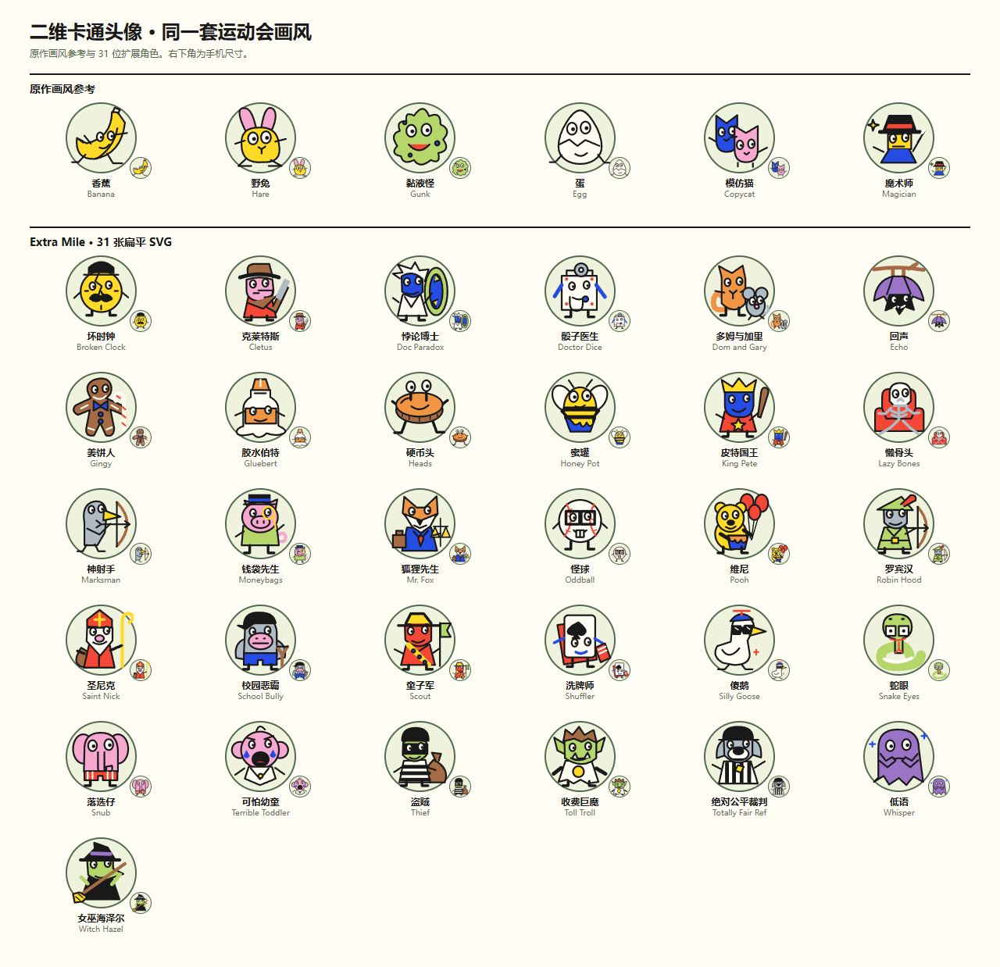
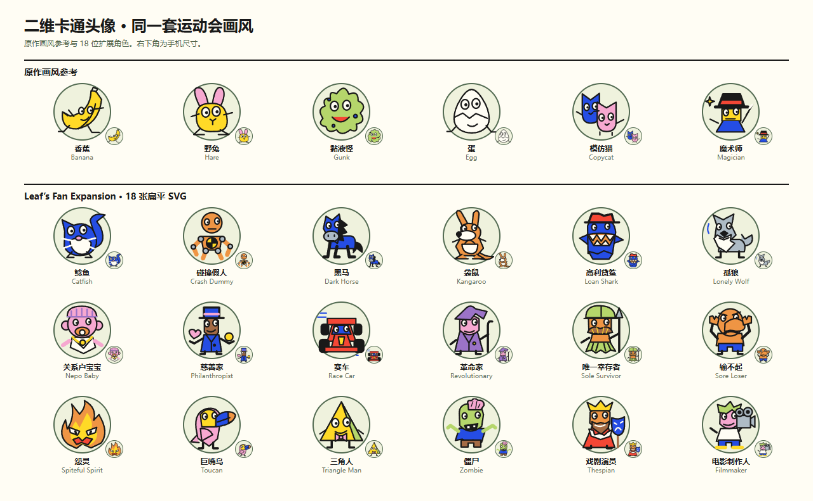
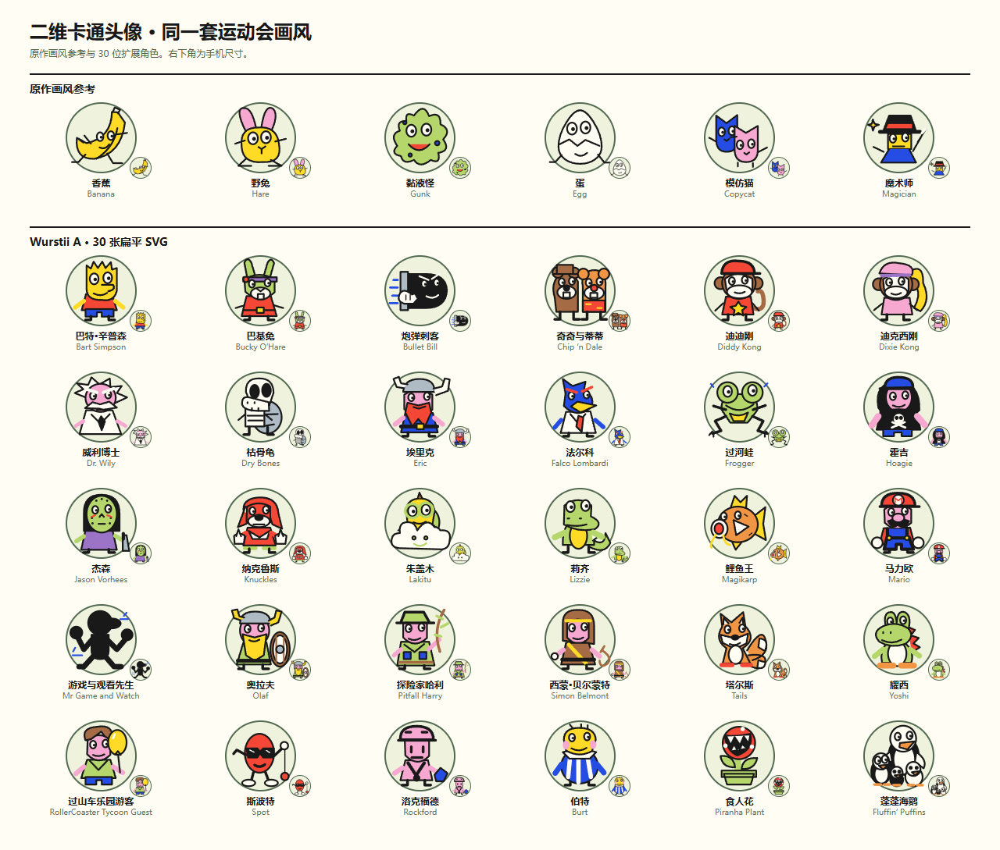

# 扩展角色的二维头像

用户要求选牌界面统一为 SVG 扁平卡通画风。本次将 Extra Mile 31 位、Leaf 18 位、Wurstii A 30 位从模型渲染缩略图改为独立编写的二维图形；基础包与 Second Wind 的 72 张原有画稿沿用。全部 151 位可用角色共用 `Avatar`，覆盖选牌、技能详情、队伍、场内信息和结果列表。

头像采用 120×120 画布、3.2 粗黑描边、圆端点、纸白眼睛和平涂原色，没有渐变、投影、嵌入位图或外部图片依赖。每个角色保留其识别轮廓与道具，例如狐狸的天平、公路收费巨魔、袋鼠育儿袋、塔尔斯双尾、蓬蓬海鹦四鸟组合。配色按现有二维画风重新解释，不要求与立体材质逐色一致；鲤鱼王的头像采用橙黄色，既有灰阶模型保留。

## 源文件与导出

- `src/client/extra-mile-portraits.tsx`：31 张；`leaf-portraits.tsx`：18 张；`wurstii-portraits.tsx`：30 张。
- `src/client/expansion-portrait-parts.tsx` 只共用配色、眼睛和脚的画法；每位角色的主体、表情和道具在各自条目编写。
- `pnpm build:avatars` 同时导出四个扩展的 SVG 至 `public/avatars/{pack}/`，并更新对应 `public/models/{pack}/manifest.json` 的 `avatar`、`avatarStyle` 与 `modelPreview`。
- 页面内联渲染同一画稿；静态 SVG 供外部预览与资源清单使用。旧 PNG/WebP、GLB、Blender 源文件保留；模型预览与二维头像分别命名。重建模型清单后再次运行 `pnpm build:avatars`。

## 验收入口

- `tests/avatars.test.ts`：151 个 ID 完整、一人一稿、统一描边、不含位图或外部引用，发布的 SVG 与实际组件一致。
- `tests/relay-browser/avatar-gallery.spec.ts`：与基础角色并列查看各包大／小头像，输出以下总览。
- `tests/browser/wurstii-review.spec.ts`：实际选牌、三个扩展的数量与选择按钮、390px 页面、刷新、头像图片请求为零；多人棋盘仍加载原有 GLB，阻断模型时二维头像仍显示。

本次实测（`792eb24` 加此头像改动）：相关头像及三套模型资产测试 128/128，浏览器选牌／多人检查 2/2，头像总览 1/1；类型检查、Node 与 Worker 前端构建通过。新导出的 79 张 SVG 合计 84,015 字节，浏览器选牌期间头像图片请求 0、页面错误 0。这里的字节数是独立 SVG 文件大小，页面使用内联组件，图形代码随前端脚本加载。未重跑整套规则测试或测量真实手机 GPU。

