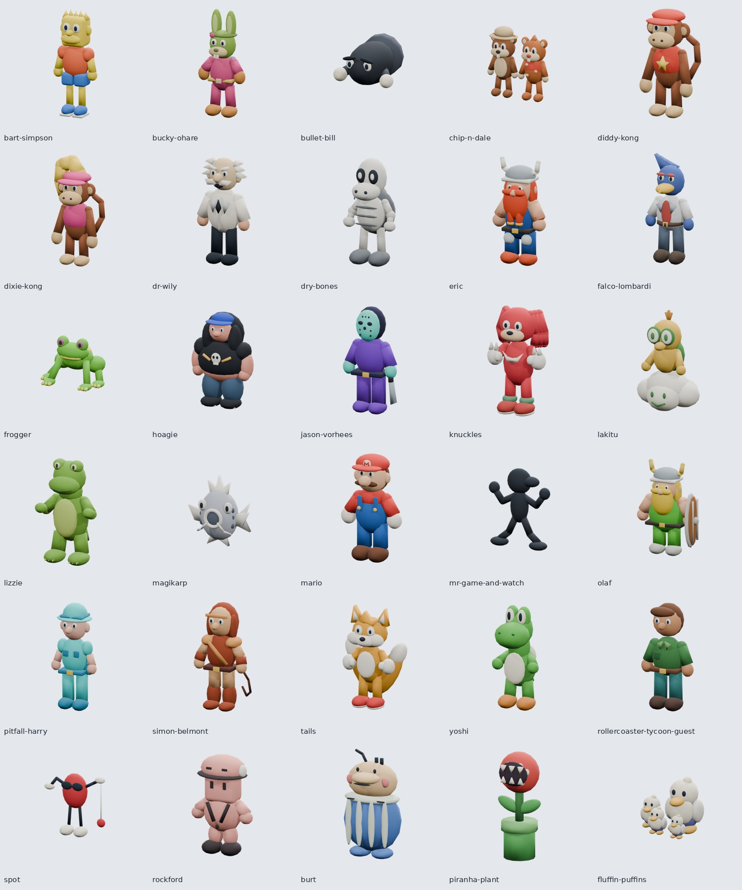

# Wurstii A 类角色美术

2026-10-22 接入用户提供的 Dots 四份 ZIP，仅对应 `WURSTII_CHARACTERS` 的30个ID。选牌、详情、场内头像使用透明立绘，棋盘按角色加载独立模型。原作和 Second Wind 的资源路径、规则结算、底座与倒地逻辑保持原样。

## 资源与制作方式

| 内容 | 路径 | 说明 |
| --- | --- | --- |
| 立绘30张 | `public/avatars/wurstii/*.png` | 1024×1024 RGBA，同一模型的 Eevee 全身渲染，非二维手绘 |
| 模型30个 | `public/models/wurstii/*.glb` | 自包含、顶点色、每角色一个材质绘制，无外部纹理 |
| 索引 | `public/models/wurstii/manifest.json` | ID、中文名、路径、根节点、包围盒、面数与动画名 |
| Blender源30份 | `assets/blender/wurstii/blend/*.blend` | 原样保留 Dots 交付文件；制作环境报告为 Blender 4.3.2 |
| 制作脚本 | `assets/blender/wurstii/scripts/` | 保留建模、导出和立绘重渲染脚本，以及同目录上一级的角色清单 |

模型采用圆润简化玩具造型。奇奇与蒂蒂是双角色，塔尔斯有双尾，蓬蓬海鹦是四只鸟；炮弹、鲤鱼王和食人花保持非人形轮廓。鲤鱼王沿用交付包的灰阶配色；原卡未展示的背部由 Dots 补全。



## 接入约定

- 只匹配已实现的30个ID，不根据 `wurstii-` 前缀接受任意未知模型。
- GLB 为 +Y 向上、+Z 朝前，静态最低点Y=0，XZ居中；放在现有底座顶面，不再做轴旋转或另加底座。
- `avatars.tsx` 使用 `object-fit: contain` 保留全身，并延迟加载图片。保留交付的原始PNG，总计约22.46 MB；不会预加载所有模型，GLB合计约5.48 MB、单个不超过301 KB。
- `ToyCharacter.tsx` 沿用现有独立实例克隆、材质缓存、AnimationMixer、加载失败回退和重试。两档画质保留顶点颜色；GLB不与其他角色共享动画状态。
- `idle`、`move`、`skill` 分别是整体呼吸、弹跳和蓄力形变，没有独立骨骼肢体动作。沿用棋盘的事件驱动动画与静止时按需渲染策略，不强制持续重绘待机动画，也不从动画修改比赛位置。

## 本机验收

验收对象为 `bea1a22` 基线上的本次美术接入工作区。独立检查实际资产，不把 Dots 报告作为已在游戏验证的证据。

- 30套文件与游戏角色ID及中文名一一对应。Pillow只读检查全部PNG：1024×1024、RGBA、非空、四边透明留白。
- Three.js GLTFLoader实际解码全部30个模型；2052～7752三角形、每角色一个网格/材质绘制；检查静态尺寸、地面、完整深度、无外部资源依赖，以及两档材质转换保留颜色。
- 每个模型克隆后分别采样三段动画，确认实际绑定并产生形变、没有水平漂移或穿地、另一实例不受影响；动画包围盒仍在高度0.98、宽深0.60范围内。
- `pnpm exec tsx --test tests/wurstii-assets.test.ts tests/avatars.test.ts tests/wurstii.test.ts tests/wurstii-match.test.ts`：79通过。
- `pnpm exec tsx --test tests/pawn-materials.test.ts tests/asset-recovery.test.ts tests/pawn-fall.test.ts tests/pawn-motion.test.ts tests/3d-assets.test.ts tests/second-wind-models.test.ts`：53通过。
- `pnpm typecheck`、`pnpm build`通过。构建保留已有的大包提示。
- 独立Edge会话连接本地内存数据库。练习页面筛选30张，逐张滚动并解码；390×844下30张全部加载且无横向溢出。查看桌面与窄屏截图，全身和透明背景正常。
- 选入奇奇与蒂蒂、蓬蓬海鹦、塔尔斯和鲤鱼王，实际让塔尔斯上场；桌面1440×900与窄屏390×844中模型正常，诊断为1个已加载模型、0个回退模型。实际掷骰5点，从8格移动到13格；切换低画质后仍为1个模型、0个回退。浏览器控制台无错误，有现有Three时钟/阴影弃用及着色器精度警告。

[桌面棋盘截图](evidence/wurstii/desktop-race.png) · [窄屏选牌截图](evidence/wurstii/mobile-cards.png)

边界：本机没有Blender，未重建或打开 `.blend` 验证编辑操作；真实手机GPU、网络性能和所有角色逐一实战尚未验收。此次未做平衡结论，也未推送或部署。

## 同步上游角色包界面（2026-10-22）

在上游 `571b0cb` 的角色包设置、Extra Mile / Leaf 扩展和复制规则上接入本批资源，五包共151张；Wurstii A可独立勾选，默认关闭。旧 Wurstii v1 引擎冻结保存，既有对局不随新配置改写。当前包界面见 [截图](evidence/wurstii/pack-settings.png)。

- 合并工作区执行 `pnpm test`：848项通过，包括30套资产、旧规则、房间配置、禁用包抽牌过滤及上游扩展交互；`pnpm typecheck`、`pnpm build`、`pnpm exec wrangler deploy --dry-run`通过。
- 浏览器实际检查五包151张、Wurstii单包30张及8人32张的数量限制；单包练习选四张，390×844下30张PNG均完成解码、无横向溢出；塔尔斯从8格起跑，模型诊断为已加载1、回退0，实际掷骰后位置改变。刷新使用最新构建后控制台0错误（保留现有Three警告）。
- 保留上游v3对无法自动收束连锁的诊断暂停：回归中“大宝宝在12格反复挤回箭头11格”及“游戏与观看先生与蹭蹭怪在狂野箭头互相触发”会暂停并保存未执行队列，不补判胜者。前者在上游原始引擎重放也得到相同暂停；混合包不保证所有技能组合都能自动结束。

## 后续重建

### PR #10 复审后的头像优化

小头像改用 `public/avatars/wurstii-small/*.webp`：30张256×256透明图片共239,102字节，原1024×1024 PNG共22,462,005字节保留在原目录。生成命令：`python scripts/build-wurstii-avatars.py`（需Pillow）。这是原立绘的缩放编码，不改人物、映射或GLB。

真实浏览器30张冷加载的响应体合计239,102字节，含浏览器记录的协议开销为248,102字节；刷新后30张均命中缓存，transferSize合计0。对照下载原PNG响应体合计22,462,005字节，页面小头像没有请求原PNG。小图保留透明背景、contain比例、lazy与async解码；缺失时显示既有通用SVG头像。Node浏览器回归同时检查高／低画质3个模型、0回退，以及单独阻断马里奥模型后的1个程序化回退；未重做GLB。见[复审报告](wurstii-pr-review.md)。

在有Blender的机器上，从仓库根目录可运行以下交付脚本；本机没有执行过：

```sh
blender -b -t 4 --python assets/blender/wurstii/scripts/produce.py -- wurstii-mario
blender -b --python assets/blender/wurstii/scripts/render_portraits.py -- wurstii-mario
```

去掉末尾 `-- ID` 会处理全部角色。输出在 `assets/blender/wurstii/` 下的 `models/`、`portraits/`、`views/` 和 `reports/`，这些生成目录已忽略；源 `.blend` 会被覆盖，重建前先保存需要保留的人工修改。完成后核对导出效果，再复制对应GLB/PNG到上述public路径，并更新manifest中的度量及模型URL版本。

脚本清单里的 `reference` 是制作时的卡图定位信息；原始参考卡片没有加入仓库，脚本建模无需读取这些卡图。完整原始交付包保留在本地 `.local/wurstii-dots-delivery/`。
